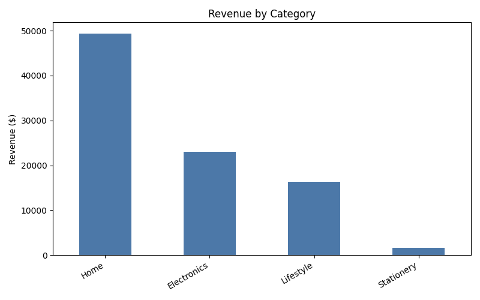
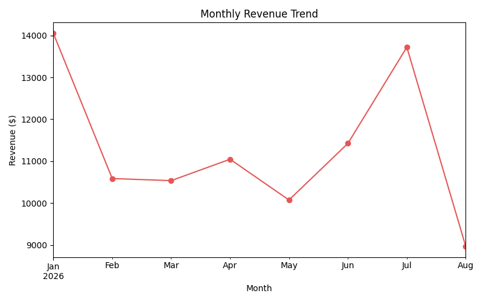

# Sales Data Cleaning & Insights Pipeline

A small pandas pipeline that takes a messy raw sales export and turns it
into something actually usable: clean data plus a couple of charts. Built
this to practice the "real" data cleaning work that never seems to show up
in tutorials — mismatched date formats, currency symbols mixed into number
columns, inconsistent casing, duplicate rows, that kind of thing.

The sample data in `data/raw/` is synthetic (I generated it, it's not real
customer data), but I deliberately made it messy in the same ways I've run
into with actual exports: three different date formats in the same column,
prices that sometimes have a `$` and sometimes don't, region names typed in
random casing, a few double-submitted orders, and some missing values.

## What the pipeline does

1. **Clean** (`pipeline/clean.py`)
   - Parses dates that show up in 3 different formats
   - Strips `$` from prices and converts to numeric
   - Normalizes region/product/category casing (with a couple of manual
     fixes for things `.title()` gets wrong, like turning "USB-C" into
     "Usb-C")
   - Drops duplicate orders and rows with missing or invalid data
     (negative quantities, missing prices, etc.)
   - Adds a `revenue` column
2. **Report** (`pipeline/report.py`)
   - Total revenue, order count, date range
   - Revenue by category and by region
   - Top products by revenue
   - Two charts: revenue by category (bar), monthly revenue trend (line)

Out of 665 raw rows, the pipeline drops about 70 (duplicates, missing
prices, bad quantities) and works with the 595 it can trust.

## Sample output




## Setup

```bash
git clone <your-repo-url>
cd sales-data-pipeline
python3 -m venv venv
source venv/bin/activate
pip install -r requirements.txt
```

## Usage

```bash
python main.py
```

By default this reads `data/raw/sales_2026_q1.csv` and writes the report to
`output/`. Both are configurable:

```bash
python main.py --input path/to/your.csv --output my_report/ --save-clean data/processed/clean.csv
```

`output/summary.json` has all the numbers if you want to pull them into
something else instead of just eyeballing the charts.

## Tests

```bash
pytest tests/ -v
```

The tests build small dataframes by hand for each specific mess (a mixed
date column, a `$` price, mismatched region casing, etc.) rather than
relying on the sample CSV, so they stay focused and don't break if the
sample data changes.

## Things I'd add next

- Right now a row with a missing price just gets dropped. For a real
  pipeline I'd probably want to log which rows got dropped and why, instead
  of just reporting a count.
- No handling yet for prices that are just wrong (e.g. a $9,999 keyboard) —
  outlier detection would be a natural next step.
- Only handles a single CSV per run. Multiple monthly files getting
  concatenated automatically would make this useful across a full quarter
  instead of one file at a time.

## License

MIT
